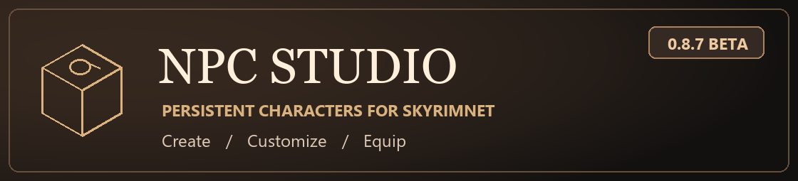

[**Download NPC Studio**](https://github.com/selenter-c/NPCStudio-GamePlugin/releases/latest) · [Installation](#install-with-mod-organizer-2) · [Report an issue](https://github.com/selenter-c/NPCStudio-GamePlugin/issues) · [Native plugin](https://github.com/selenter-c/NPCStudio-NativePlugin) · [Build tools](https://github.com/selenter-c/NPCStudio-Build)

> [!NOTE]
> **Built for SkyrimNet and its community.** Create your own cast of permanent characters and bring them into the SkyrimNet playthroughs and stories you share with others.
>
> [**Join the SkyrimNet community on Discord**](https://discord.gg/gHHS7HpJS9) · [Explore SkyrimNet on GitHub](https://github.com/MinLL/SkyrimNet-GamePlugin)

## Build a cast for SkyrimNet

NPC Studio is an in-game editor for creating permanent NPCs in Skyrim Special Edition 1.6.1170.

Each character uses a persistent game reference. NPCs start as blank characters that generally stand idle. NPC Studio gives them a name, appearance, and gear, while SkyrimNet or another AI plugin can provide dialogue and actions. The beta includes the editor and persistent NPCs. Automatic SkyrimNet registration and biography generation are still in development.

## Features

- **400 persistent slots** with separate pools of 200 female and 200 male NPCs. Create a character nearby, summon them later, hide them from the world, or clear their slot for reuse.
- **Appearance editing** with live try-on for hair, hair color, eyes, eyebrows, beard, and skin tone. Change race and height for your own NPCs, or open the appearance editor while looking at a supported NPC in the world.
- **Equipment and outfits** with a searchable item catalog, individual equip and remove actions, and built-in and custom gear presets.
- **Live 3D inspection** for NPCs and items, with camera controls, lighting, and persistent character portraits.
- **English and Russian UI**, with a configurable hotkey, palette, and scale.

## Requirements

| Component | Purpose |
| --- | --- |
| **Skyrim Special Edition, Steam runtime 1.6.1170** | Supported runtime for this beta |
| [SKSE64 2.2.6](https://skse.silverlock.org/) | Loads the native plugin |
| [Address Library for SKSE Plugins, Anniversary Edition package](https://www.nexusmods.com/skyrimspecialedition/mods/32444) | Provides runtime addresses for 1.6.1170 |
| [Magelight UI](https://www.nexusmods.com/skyrimspecialedition/mods/193303) | Hosts the in-game editor. Use a build exposing the Magelight v4 API and install its runtime dependencies |

[SkyrimNet](https://github.com/MinLL/SkyrimNet-GamePlugin) is recommended for AI-driven dialogue and behavior. The editor itself runs independently. The optional naming rules are for [NPCs Names Distributor](https://www.nexusmods.com/skyrimspecialedition/mods/73081) and [Spell Perk Item Distributor](https://www.nexusmods.com/skyrimspecialedition/mods/36869), including [Tamrielic Names](https://www.nexusmods.com/skyrimspecialedition/mods/73153) and its [Russian translation with Obscuring Names](https://www.nexusmods.com/skyrimspecialedition/mods/145614). Physics-enabled hairstyles require [Faster HDT-SMP](https://www.nexusmods.com/skyrimspecialedition/mods/57339) and any requirements of the hairstyle itself.

## Install with Mod Organizer 2

1. **Enable automatic detection in MO2.** Open **Settings → Plugins → Fomod Installer**, set **`use_any_file`** to **`true`**, and click **OK**. This is a one-time MO2 setting. If the installer is already open, close it and reopen the archive after saving the setting.
2. Install SKSE64, the AE Address Library, and Magelight UI. Enable the library mods in the MO2 profile where you plan to use NPC Studio.
3. From the release, save `Prepare-NPCStudio.ps1` next to `NPCStudio-0.8.7-beta.3-fomod.zip` and run `powershell -ExecutionPolicy Bypass -File .\Prepare-NPCStudio.ps1` in that folder. The helper downloads the original 3D preview files, verifies the archive hash, and produces `NPCStudio-0.8.7-beta.3-local-fomod.zip`.
4. Open the generated ZIP in MO2. The installer preselects **NPCs Names Distributor compatibility** if it finds NPCs Names Distributor or Tamrielic Names. Otherwise, it selects **Standard**. Review the selection and click **Install**. The compatibility rules require SPID.
5. Enable NPC Studio and `NPCStudio.esp`, then launch Skyrim through SKSE. In the game world, press **Shift + 8** using the top-row number key.

> [!TIP]
> If a library you already installed is unchecked, confirm that it is enabled in the current MO2 profile and that `use_any_file` is set to `true`. The library checks confirm file presence. Skyrim and SKSE have separate version checks.

Use a separate save for beta testing. Character assignments and appearance are saved with the Skyrim save and its matching SKSE co-save. Settings, custom presets, categories, and portraits live under `Data/SKSE/Plugins/NPCStudio`, often in MO2's Overwrite directory. Keep those files when replacing an installation. Earlier development snapshots with different save formats may require a new game.

## Repositories

| Repository | Contents |
| --- | --- |
| **GamePlugin** | Releases, persistent NPC records, Magelight UI, outfit presets, and the MO2 installer |
| [NativePlugin](https://github.com/selenter-c/NPCStudio-NativePlugin) | C++ SKSE plugin for the NPC pool, editing, and renderer integration |
| [Build](https://github.com/selenter-c/NPCStudio-Build) | ESP generation, native build, tests, and packaging |

## Credits

- [SkyrimNet](https://github.com/MinLL/SkyrimNet-GamePlugin) and [IntelEngine](https://github.com/galanx/IntelEngine-GamePlugin) ([native plugin](https://github.com/galanx/IntelEngine-NativePlugin)) informed the SkyrimNet-oriented workflow.
- [SeverActions](https://github.com/Severause/SeverActions) and [Magelight UI](https://www.nexusmods.com/skyrimspecialedition/mods/193303) by Severause provided the rendering and UI technology.
- [Build a Follower](https://www.nexusmods.com/skyrimspecialedition/mods/185471) inspired the reserved-slot design. [NPC Preset Applier](https://www.nexusmods.com/skyrimspecialedition/mods/193575) and [RaceMenu](https://www.nexusmods.com/skyrimspecialedition/mods/19080) informed the appearance workflow.
- Developed with **OpenAI Codex**, which helped solve technical implementation problems in the SKSE integration, rendering, save handling, and UI.

The beta includes third-party notices for its native code.
